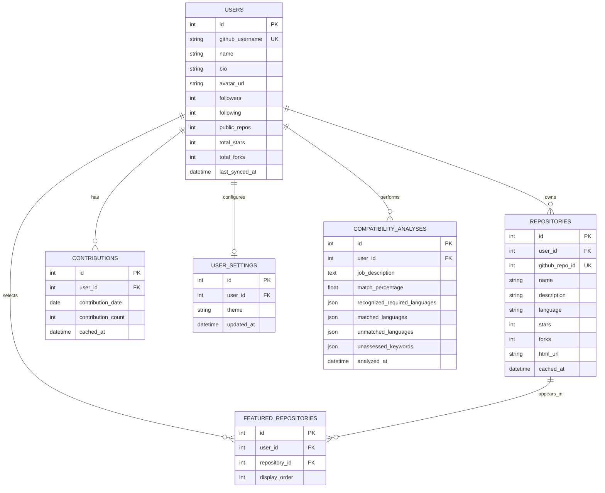

# GitHub Developer Portfolio — Database Architecture and Schema

**Database:** SQLite  
**ORM:** SQLAlchemy  
**Migrations:** Alembic  
**Database file (local development):** `backend/portfolio.db`

## 1. Database choice

Use SQLite because:
- It is explicitly required by the Quantiphi problem statement for local caching.
- It is file-based and needs no separate database server.
- It supports relational tables, foreign keys, unique constraints, and indexes.
- It is sufficient for a small, single-instance MVP.
- It integrates cleanly with SQLAlchemy.

Do not add PostgreSQL, MongoDB, Redis, or another database for this MVP.

## 2. Database responsibilities

SQLite stores:
1. Cached GitHub profile metadata.
2. Cached public repository metadata.
3. Daily contribution records, when successfully retrieved.
4. User dashboard settings.
5. Featured repository selections.
6. Saved compatibility analyses.

DeepWiki documentation and chat responses do not need to be persisted for the MVP. Keep current chat and interview interaction state in frontend memory unless persistent history is explicitly added later.

## 3. Core tables

Start with six core tables:

| Table | Purpose |
|---|---|
| `users` | One cached GitHub profile per username |
| `repositories` | Cached public repository metadata |
| `contributions` | Daily contribution counts |
| `user_settings` | Basic dashboard preferences |
| `featured_repositories` | Selected and ordered projects |
| `compatibility_analyses` | Saved Vibe Check analyses |

Do not create an `analysis_skills` table initially; store matched, unmatched, and unassessed skill lists as JSON columns in the analysis row.

## 4. Table definitions

### 4.1 `users`

One row per GitHub username.

| Column | SQL type | Constraints/default |
|---|---|---|
| `id` | INTEGER | Primary key |
| `github_username` | VARCHAR(100) | NOT NULL, UNIQUE, indexed |
| `name` | VARCHAR(255) | Nullable |
| `bio` | TEXT | Nullable |
| `avatar_url` | TEXT | Nullable |
| `github_url` | TEXT | Nullable |
| `followers` | INTEGER | NOT NULL, default 0 |
| `following` | INTEGER | NOT NULL, default 0 |
| `public_repos` | INTEGER | NOT NULL, default 0 |
| `total_stars` | INTEGER | NOT NULL, default 0 |
| `total_forks` | INTEGER | NOT NULL, default 0 |
| `created_at` | DATETIME | NOT NULL |
| `updated_at` | DATETIME | NOT NULL |
| `last_synced_at` | DATETIME | Nullable |

Notes:
- `github_username` is the stable application lookup key.
- `last_synced_at` records the last successful synchronization.
- Totals should be recomputed from normalized data where appropriate, not blindly incremented on every sync.

### 4.2 `repositories`

One row per cached public GitHub repository.

| Column | SQL type | Constraints/default |
|---|---|---|
| `id` | INTEGER | Primary key |
| `user_id` | INTEGER | NOT NULL, FK → `users.id` |
| `github_repo_id` | INTEGER | NOT NULL, UNIQUE |
| `name` | VARCHAR(255) | NOT NULL |
| `description` | TEXT | Nullable |
| `language` | VARCHAR(100) | Nullable |
| `stars` | INTEGER | NOT NULL, default 0 |
| `forks` | INTEGER | NOT NULL, default 0 |
| `html_url` | TEXT | NOT NULL |
| `is_fork` | BOOLEAN | NOT NULL, default false |
| `is_private` | BOOLEAN | NOT NULL, default false |
| `updated_at` | DATETIME | Nullable; GitHub repository update time |
| `cached_at` | DATETIME | NOT NULL; local cache write time |

Constraints and indexes:
- Foreign key `user_id` references `users.id`.
- Unique `github_repo_id` prevents duplicate GitHub repository records.
- Index `user_id` for efficient per-user listing.
- Optionally add composite index `(user_id, stars)` if sorting becomes a bottleneck.

Only public repositories are in scope. `is_private` may be retained as defensive metadata, but private repository fetching is not part of the MVP.

### 4.3 `contributions`

One row per user per calendar date.

| Column | SQL type | Constraints/default |
|---|---|---|
| `id` | INTEGER | Primary key |
| `user_id` | INTEGER | NOT NULL, FK → `users.id` |
| `contribution_date` | DATE | NOT NULL |
| `contribution_count` | INTEGER | NOT NULL, default 0 |
| `cached_at` | DATETIME | NOT NULL |

Constraints and indexes:
- Unique constraint `(user_id, contribution_date)`.
- Index `user_id`.
- A zero-contribution date may be stored explicitly or generated for display; streak logic must treat missing dates as zero when the calendar range is known.

### 4.4 `user_settings`

One settings row per user.

| Column | SQL type | Constraints/default |
|---|---|---|
| `id` | INTEGER | Primary key |
| `user_id` | INTEGER | NOT NULL, UNIQUE, FK → `users.id` |
| `theme` | VARCHAR(20) | NOT NULL, default `light` |
| `created_at` | DATETIME | NOT NULL |
| `updated_at` | DATETIME | NOT NULL |

No login is required in the MVP. Settings associated with a public username must not be represented as private or securely owned. Theme may instead be stored in browser local storage if that is simpler; avoid maintaining duplicate sources of truth.

### 4.5 `featured_repositories`

Join table linking users to repositories they want to showcase.

| Column | SQL type | Constraints/default |
|---|---|---|
| `id` | INTEGER | Primary key |
| `user_id` | INTEGER | NOT NULL, FK → `users.id` |
| `repository_id` | INTEGER | NOT NULL, FK → `repositories.id` |
| `display_order` | INTEGER | NOT NULL, default 0 |
| `created_at` | DATETIME | NOT NULL |

Constraints:
- Unique `(user_id, repository_id)`.
- Index `user_id`.
- Validate that the selected repository belongs to the same user.
- Order portfolio cards by `display_order`.

### 4.6 `compatibility_analyses`

One row per Vibe Check job-description analysis.

| Column | SQL type | Constraints/default |
|---|---|---|
| `id` | INTEGER | Primary key |
| `user_id` | INTEGER | NOT NULL, FK → `users.id` |
| `job_description` | TEXT | NOT NULL |
| `match_percentage` | FLOAT | Nullable only when no recognized languages exist |
| `recognized_required_languages` | JSON/TEXT | NOT NULL |
| `matched_languages` | JSON/TEXT | NOT NULL |
| `unmatched_languages` | JSON/TEXT | NOT NULL |
| `unassessed_keywords` | JSON/TEXT | NOT NULL |
| `score_basis` | VARCHAR(100) | NOT NULL |
| `analyzed_at` | DATETIME | NOT NULL |

Notes:
- Use SQLAlchemy JSON type where supported by the installed SQLite/SQLAlchemy combination, or serialize JSON safely into TEXT.
- Store canonical language names, not arbitrary casing/aliases.
- `score_basis` should identify the algorithm, e.g. `distinct_primary_languages_in_cached_repositories`.
- The job description may contain personal or confidential text. Do not expose analyses through a public portfolio by default.

## 5. Relationships

```text
users
 ├── 1 : many ── repositories
 ├── 1 : many ── contributions
 ├── 1 : 1    ── user_settings
 ├── 1 : many ── featured_repositories
 └── 1 : many ── compatibility_analyses

repositories
 └── 1 : many (across users' selections) ── featured_repositories
```

For this MVP, a repository belongs to one cached GitHub user row. `featured_repositories` records which repositories that user selects and in what order.

## 6. Mermaid ER diagram



## 7. Mandatory Vibe Check data flow

The Vibe Check must use the `repositories.language` values stored in SQLite. It must not make an unrelated GitHub call just to calculate the score if cached repository language data is already available.

```text
Job description
      |
      v
Extract recognized programming-language keywords
      |
      v
Normalize aliases and deduplicate
      |
      v
Read distinct primary languages from SQLite repositories
      |
      v
Compare required language set with cached language set
      |
      +----> matched languages
      |
      +----> unmatched languages
      |
      v
Calculate percentage on backend
      |
      v
Save compatibility_analyses row
      |
      v
Return result to frontend
      |
      v
Display Match Percentage badge at top of profile
```

Formula:

`match_percentage = matched_required_language_count / recognized_required_language_count * 100`

Example:
- Job description contains recognized languages: Python, C++, JavaScript.
- Cached repositories contain primary languages: Python, JavaScript.
- Matched: Python, JavaScript.
- Unmatched: C++.
- Score: `2 / 3 * 100 = 66.67%`.

Do not count non-language technologies such as FastAPI, Docker, PostgreSQL, Redis, or Kubernetes in this language-only score. Return them separately as unassessed if useful.

Special cases:
- No recognized languages: return a null score and explanatory message.
- No cached repositories: ask the user to synchronize GitHub data.
- No matching languages: return 0% if there are recognized requirements and valid cached repository evidence.
- Multiple mentions/aliases of the same language: count once.

## 8. Cache policy

Suggested configurable defaults:

| Data | TTL |
|---|---:|
| Profile | 1 hour |
| Repositories | 1 hour |
| Contributions | 6 hours |
| User settings | No expiry |
| Featured repository selections | No expiry |
| Compatibility analyses | Persist until user/application cleanup |

Cache behavior:
1. Read cached record and timestamp.
2. If fresh, return it.
3. If expired, call GitHub.
4. On success, upsert and update timestamp.
5. On failure, preserve existing record and return stale data with an indicator if available.
6. If no record exists, return a meaningful external-service error.

Use timezone-aware UTC timestamps consistently.

## 9. SQLAlchemy and SQLite implementation notes

- Enable SQLite foreign-key enforcement on each connection (`PRAGMA foreign_keys=ON`).
- Use SQLAlchemy declarative models.
- Use Alembic migrations rather than relying only on `create_all` after the initial schema is established.
- Use unique constraints and upserts to prevent duplicate sync records.
- Use transactions for multi-table synchronization.
- Do not store GitHub tokens or DeepWiki credentials in database rows.
- Add indexes for username, repository owner/user lookup, contribution date lookup, and analysis lookup.
- Use a reasonable SQLite connection configuration for FastAPI. Avoid unnecessary concurrency complexity for this local MVP.

## 10. Tables intentionally omitted

Do not create these for the first version:

- `chat_messages`
- `interview_sessions`
- `interview_answers`
- `deepwiki_documents`
- `embeddings`
- `vector_chunks`
- `analysis_skills`

Reason: current DeepWiki/chat/interview state can remain transient, and the MVP does not require a custom retrieval pipeline or persistent interview history. Add such tables only when a concrete requirement needs them.
